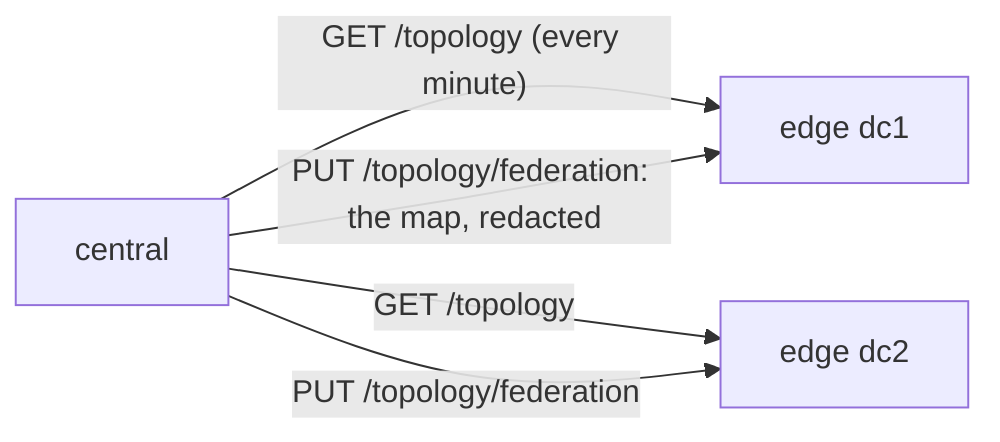

# Federation across datacenters

One instance per datacenter doing the local gathering, one central that
federates them — so consumers only ever talk to the central, and no SSH key or
firewall opening needs global reach.

This page is the topology. The built-in `remote` connector it rests
on lives in [connectors](connectors.md), and [views](views.md) are how a consumer
stops needing to know which instance a host sits behind.

- [Edge configuration (each DC)](#edge-configuration-each-dc)
- [Central configuration](#central-configuration)
- [The scope contract](#the-scope-contract)
- [Verifying a federation](#verifying-a-federation)
- [Operational notes](#operational-notes)

For hosts spread over multiple datacenters, don't SSH across the WAN from
one central instance (firewall openings into every DC, one key with global
reach, WAN latency on every handshake). Deploy **one instance per DC** doing
the local work, and **one central** that federates them with
the built-in `connector: remote` — consumers only ever talk to the central:

```
          DATACENTER A                                  DATACENTER B
┌─────────────────────────────┐               ┌─────────────────────────────┐
│      local fleet (LAN)      │               │      local fleet (LAN)      │
│  web01 . web02 . db01 . ... │               │  app01 . app02 . db02 . ... │
│         ^                   │               │         ^                   │
│         │ parallel SSH      │               │         │ parallel SSH      │
│         │ (russh, key that  │               │         │ (russh, key that  │
│         │  never leaves dc1)│               │         │  never leaves dc2)│
│  ┌──────┴───────────────┐   │               │  ┌──────┴───────────────┐   │
│  │  unified-api-dc1     │   │               │  │  unified-api-dc2     │   │
│  │  > src-fleet  (ssh)  │   │               │  │  > src-fleet  (ssh)  │   │
│  │  > src-d42 (script)  │   │               │  │  > src-netbox        │   │
│  │  cache <-> PVC       │   │               │  │  cache <-> PVC       │   │
│  │  key-central ....... │<──┼── restricted  │  │  key-central ....... │   │
│  │   (src-fleet only)   │   │   per edge    │  │   (src-fleet only)   │   │
│  └──────────┬───────────┘   │               │  └──────────┬───────────┘   │
└─────────────┼───────────────┘               └─────────────┼───────────────┘
              │                                             │
              │        HTTPS . GET /dataset + /status       │
              │        restricted X-API-Key                 │
              │        the data's REAL age travels along    │
              └──────────────────────┬──────────────────────┘
                                     v
                     ┌───────────────────────────────┐
                     │      unified-api (CENTRAL)    │
                     │   > src-dc1 (remote) ───┐     │
                     │   > src-dc2 (remote) ───┤     │
                     │   cache <-> PVC         │     │
                     │   ep-global <───────────┘     │
                     │   (merged world inventory)    │
                     └───────────────┬───────────────┘
                                     │ POST /api/v1/endpoints/ep-global
                                     v
                    AWX / Ascender . AnsibleForms . curl
```

Arrows point in the direction the CONNECTION is initiated (the central
pulls the edges, consumers pull the central) — the only firewall openings
are HTTPS from the central to each edge.

The wire protocol is the API itself: `GET /dataset` returns exactly the
Dataset shape a connector must produce, and `/status` provides the data's
real age so freshness reporting stays truthful across hops.

---

## Edge configuration (each DC)

A completely normal instance — its sources are whatever that DC needs (see
the worked example above). The only federation-specific piece is a
**restricted API key** for the central:

```yaml
# edge: api_keys/key-central.yaml
api_keys:
  - name: key-central
    description: "Central aggregator"
    env_vars:
      key: "UNIFIED_API_KEY_CENTRAL"
    # restricted (default role): the central can read THIS source and nothing else
    sources: ["src-fleet"]
```

The deployment injects `UNIFIED_API_KEY_CENTRAL` on the edge (same secret
mechanisms as everything else). Generate one distinct key per edge.

---

## Central configuration

What the central instance needs in order to treat each edge as a remote source it can read.

```yaml
# central: credentials/cred-edge-dc1.yaml — one token credential per DC
credentials:
  - name: cred-edge-dc1
    description: "Edge datacenter A API key"
    type: "token"
    env_vars:
      token: "EDGE_DC1_TOKEN"  # reads env EDGE_DC1_TOKEN
```

```yaml
# central: sources/src-dc1.yaml — one remote source per DC
sources:
  - name: src-dc1
    description: "Datacenter A"
    connector: "remote"             # built in: no connector item to write
    credentials: ["cred-edge-dc1"]
    sync_interval_seconds: 120      # how often the central re-pulls the edge
    ttl_seconds: 600
    config:
      url: "https://unified-api-dc1.example.com"
      source: "src-fleet"           # the source id ON THE EDGE
      # http_timeout_seconds: "30"  # default 30
      # insecure_tls: "true"        # only for self-signed edges; opt-in
```

`config.url` and `config.source` are both required. Before 0.35 the edge's
source id rode in `script_path`, and a remote source had to name a stub project
it never used; the built-in connector needs neither (a 0.34 central is converted
that way on upgrade — see [configuration](configuration.md#upgrading-from-034)).

```yaml
# central: endpoints/ep-global.yaml — one merged world view for consumers
endpoints:
  - name: ep-global
    description: "Global inventory"
    sources: ["src-dc1"]          # add one id per DC
    script_path: "tests/adapters/out/output/ansible_inventory.py"
```

Secrets the central's deployment must inject: `EDGE_DC1_TOKEN` (the value of
the edge's `UNIFIED_API_KEY_CENTRAL`) — one env var per DC — plus the
central's own API keys for its consumers.

---

## The scope contract

Beyond the dataset itself, an edge can tell the central **which hosts it owns** —
so a central [view](views.md) routes per-host reads without duplicating the edge's config.

Every source serves `GET /api/v1/sources/{id}/scope`: the ownership claim
derived from **configuration, never cache contents** — an explicit
`advertise_scope` block (`groups` + `hosts`), or the `hosts_from_source`
pattern an SSH source already gathers by. On the edge that means the claim is
maintained exactly once, where the gathering is configured:

```yaml
# edge: sources/src-fleet.yaml — the source states what it owns
sources:
  - name: src-fleet
    connector: "ssh-facts"
    # ... credentials, config, TTLs ...
    ttl_seconds: 600
    advertise_scope:
      groups: ["dc1"]            # optional when hosts_from_source already says it
```

The central's remote syncs fetch the edge's `/scope` alongside the dataset,
best effort, and remember the **last-known claim**: an unreachable edge keeps
routing the way it last claimed (stale routing beats no routing). A view
member opts into that claim with `owns.advertised: true` — the full resolution
order (live claim → last-known → declared fallback → nothing, never
everything) lives in [views → advertised ownership](views.md#advertised-ownership).

**Mixed-version rollouts degrade cleanly.** An edge too old to serve `/scope`
answers `404`; the central treats that as "no claim" and the member falls back
to its declared `groups`/`hosts`, exactly as before the feature existed. So
the safe order is: keep the declared fallback while edges upgrade, watch each
member's `ownership_mode` in `GET /status` flip from `fallback` to
`advertised`, and only then delete the fallback — from that point the edge's
config is the single truth, and adding a datacenter's worth of hosts to an
edge never needs a central change again.

---

## Verifying a federation

A federation is working when the central sees what the edge sees; these calls check that end to end.

```bash
# 1. the edge has data of its own
curl -s -H "x-api-key: $EDGE_KEY" https://unified-api-dc1.../api/v1/sources/src-fleet/status \
  | jq .dataset_age_seconds        # e.g. 42 — remember this number

# 2. sync the central and read the same source through it
curl -s -X POST -H "x-api-key: $CENTRAL_KEY" https://central.../api/v1/sources/src-dc1/sync | jq .total_hosts
curl -s -H "x-api-key: $CENTRAL_KEY" https://central.../api/v1/sources/src-dc1/status \
  | jq .dataset_age_seconds        # must be >= the edge's number, NOT 0
```

That second check is the point of the native connector: the central reports
the **origin's** age (dataset-level and per-host). If it says `0` right
after a sync of old edge data, something is off.

Failure modes, all loud:

| Symptom in the sync error | Meaning |
|---|---|
| `answered 401` | The token credential isn't the edge's API key |
| `answered 403` | The edge key exists but isn't allowed that source id |
| `answered 404` | Wrong `config.source` (the remote source id), or the edge hasn't synced it yet |
| `request … failed` (network) | WAN/DNS/TLS problem — the central keeps serving its last good copy |
| WARN `could not read remote ages` | Data arrived fine; only the age lookup failed (treated as fresh) |

---

## Seeing the federation: `GET /api/v1/topology`

Every instance can describe the federation from where it stands:

```bash
curl -s -H "X-API-Key: $KEY" https://central.example.com/api/v1/topology?depth=2 | jq
```

```json
{
  "version": "0.34.0",
  "sources": 30,
  "peers": [
    {
      "url": "https://unified-api-dc1.example.com:8443",
      "sources": [
        { "source_id": "src-dc1", "remote_source": "src-fleet", "cached": true,
          "hosts": 437, "age_seconds": 120, "consecutive_failures": 0 }
      ],
      "instance": { "version": "0.34.0", "sources": 3, "peers": [] }
    }
  ]
}
```

- **Peers come from configuration**: every `connector: remote` source,
  grouped by its `config.url`. No registry to keep in sync.
- **Each peer is asked in turn**, with the token credential its sources
  already use, and nests its own answer under `instance`. `depth` (default 2,
  at most 3) bounds the hops, so a loop of instances federating each other
  ends.
- **A peer that cannot be asked keeps its place** with `error` set
  (`unreachable`, `did not answer in time`, a refused key). A peer older than
  this route answers with its version only, and its own peers stay unknown.
- **Any key may ask; each sees the peers behind the sources it may read.** An
  edge answers its central's restricted key, and nothing about sources outside
  that key's scope.
- Each peer has 8 seconds to answer, plus 8 more for each level it will ask
  below it: the map is a page someone is waiting on, not a sync, and a middle
  peer still waiting on a dead one further away must not be mistaken for dead
  itself. An older peer's fallback (its index) counts within the same time.
- A restricted key sees each peer's version, not the peer's own peers: those
  were asked with this instance's key, not the caller's.

The UI's Topology page draws this as a tree. Each line is green where data gets through, red where
the peer is unreachable or its pulls fail.

## The map on an edge: pushed down from the central

An edge reads from nobody, so its own `GET /topology` is just itself. The central fills the gap:

- **Every minute** an instance with remote sources maps the federation (depth 2) and sends it to
  each peer that answered: `PUT /api/v1/topology/federation`, with the key its remote sources use.
  When two sources read one edge with different keys, the push uses the one the map asked with:
  the first source by id.
- **What an edge is sent is redacted** the way a restricted caller's map is. It shows every
  peer's name and version, but not that peer's own map (asked with the central's keys).
- **Errors stay on the central.** Why a peer was not asked is generic, and a failing link says it
  fails (`consecutive_failures`) without its error: those name the central's env vars and Vault
  paths.
- **No edge configuration.** The central's key is restricted to the sources it reads, and that is
  enough: any key may push, and the map is stored under the key's name (`key-central` → central).
- **Only a key sent with the request pushes.** A browser session cannot, even one signed in with
  a key: the answer is a `403`.
- **The central's address comes from its `server.url`** (`config.yaml`), since a process only
  knows the port it listens on. Unset, the edge shows the central without a URL.
- **Admins read it** at `GET /api/v1/topology/federation`. The edge's Topology page then draws the
  central at the root and this instance among its peers, and the Overview counts the same map.
- **In memory, and it expires.** A restart empties it until the next push (within a minute); a
  sender silent for ten minutes is dropped. Past three minutes the page says the map may be stale.
- **Older edges are skipped quietly**: a 404 or 405 to the push is not a failure. Other failures
  are logged once when they start, and once when they stop.



## Operational notes

How the arrangement behaves once it is running, and what it costs to change its shape.

- **A WAN cut does not lose data**: the central's cached copy keeps being
  served (stale beats nothing) and its `unified_api_sync_total{result="error"}`
  metric flags the broken link — alert on that.
- **An unchanged edge costs almost nothing to poll**: full pulls revalidate
  with the edge's `ETag` and a `304` skips the transfer — see
  [connectors → remote](connectors.md#remote-sources--federation-connector-remote).
  `unified_api_remote_not_modified_total` counts the skips, so a low ratio of
  skips to syncs on a source that rarely changes is worth a look.
- **Adding a DC** = deploy an edge (same manifests, different config), give
  it a `key-central`, add one credential + one remote source on the central,
  and append its id to `ep-global`. No consumer changes.
- **Rotation**: swap the edge's `UNIFIED_API_KEY_CENTRAL` value and the
  central's `EDGE_*_TOKEN` at the same time; both are env vars, both
  instances restart independently.
- **TTL sizing**: the central's `ttl_seconds` should be ≥ the edge's sync
  interval + the central's own — freshness at the central reflects the
  ORIGIN's age, so an edge that stops syncing will (correctly) show as stale
  at the central even while the transfer keeps succeeding.
- Centrals can be federated by another instance in turn (regions → global),
  and the same pattern aggregates non-geographic pairs: dev + prod, homelab
  + work.
